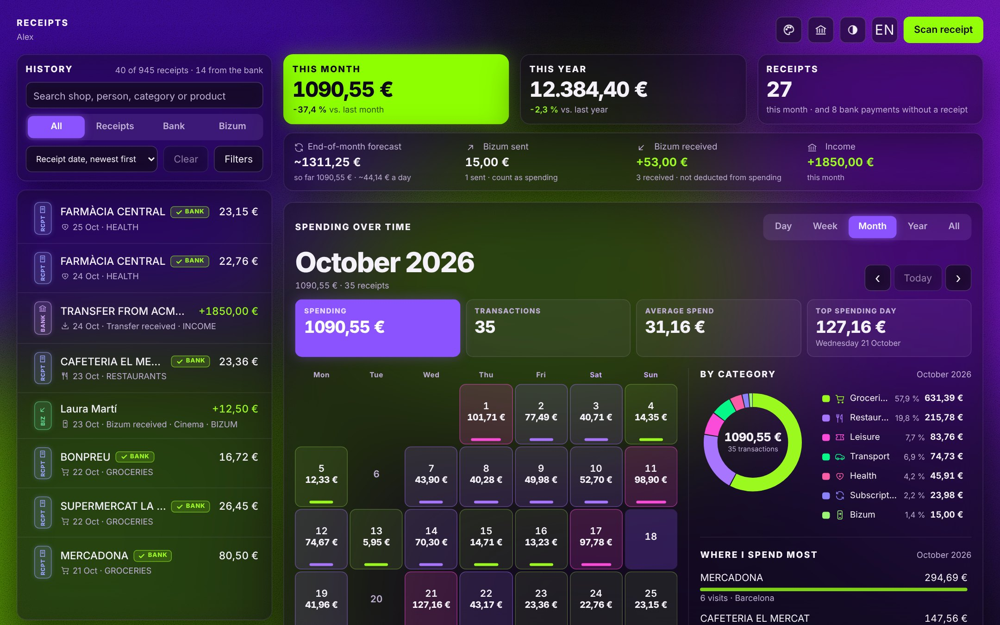
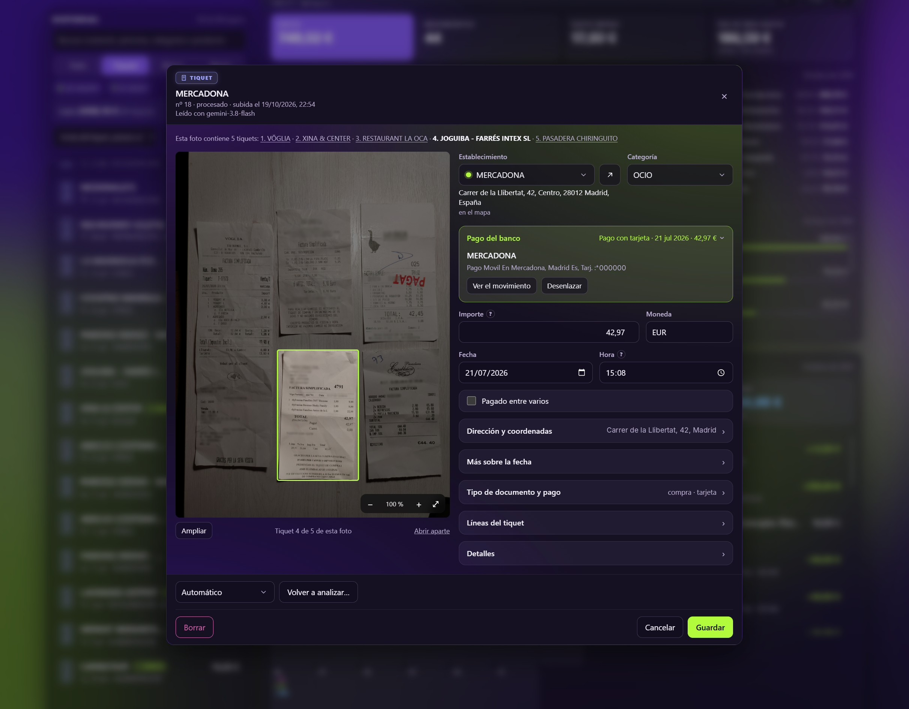
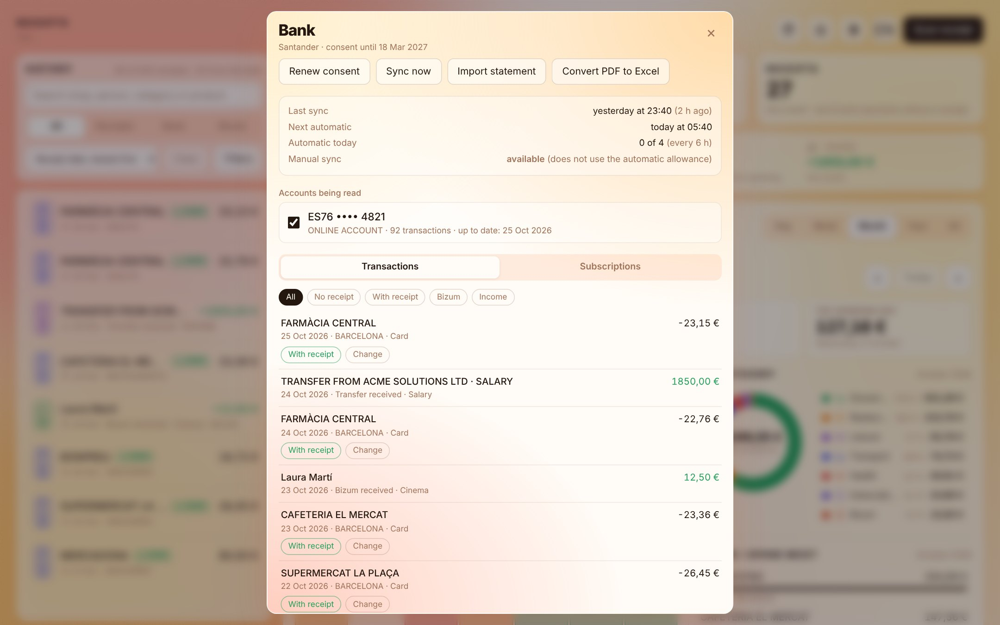
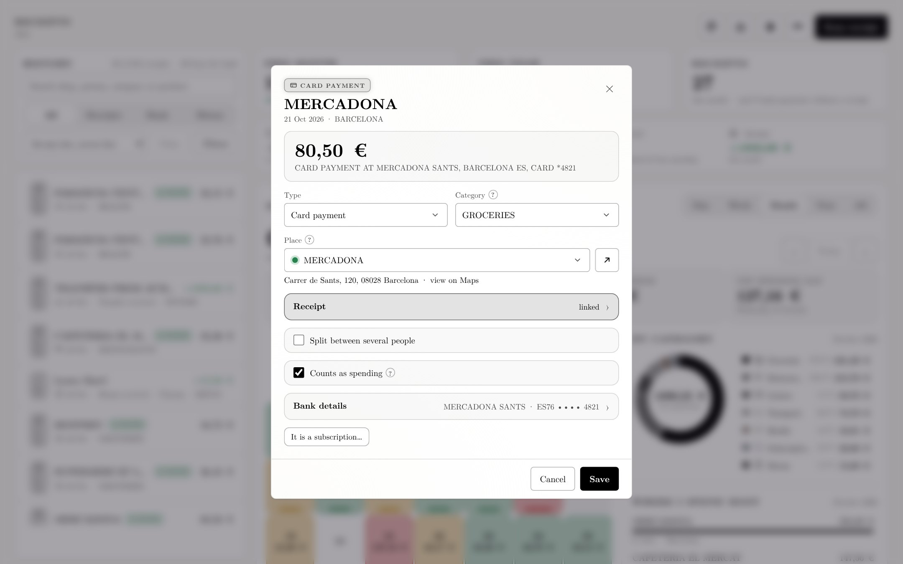
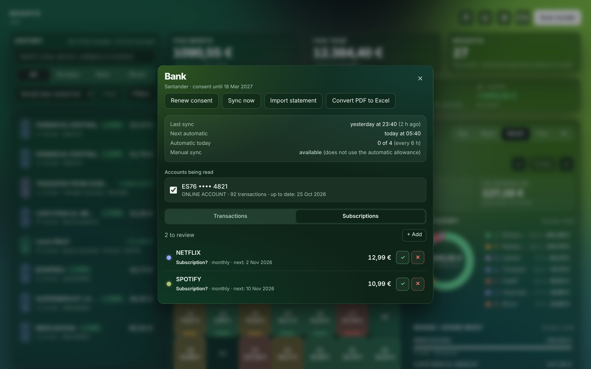
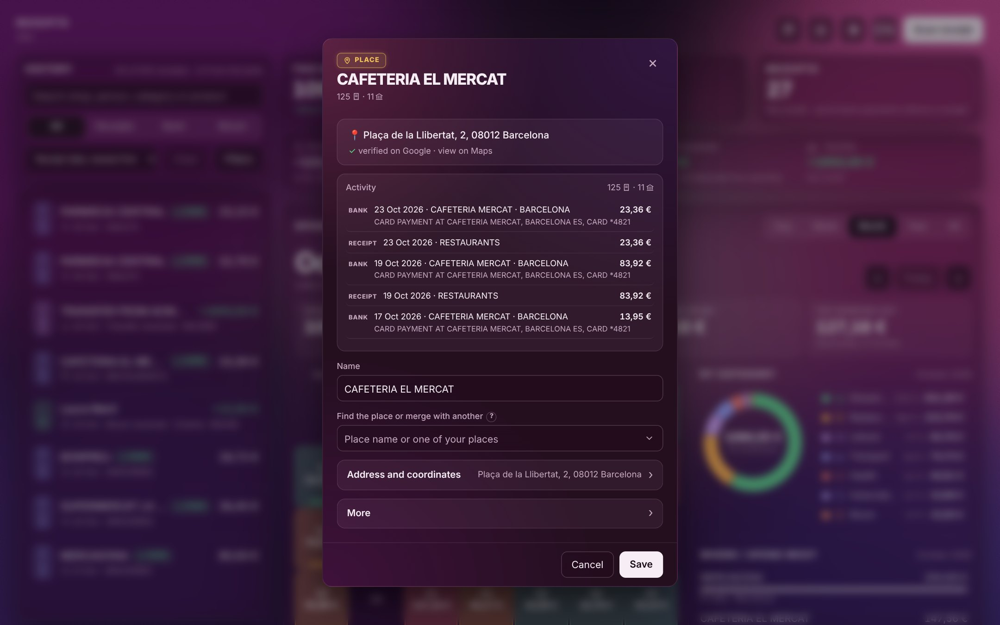
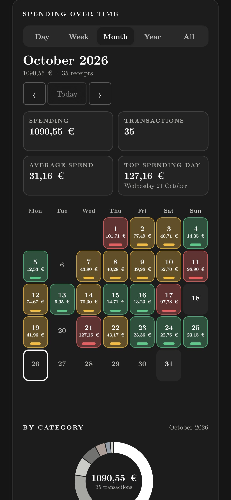
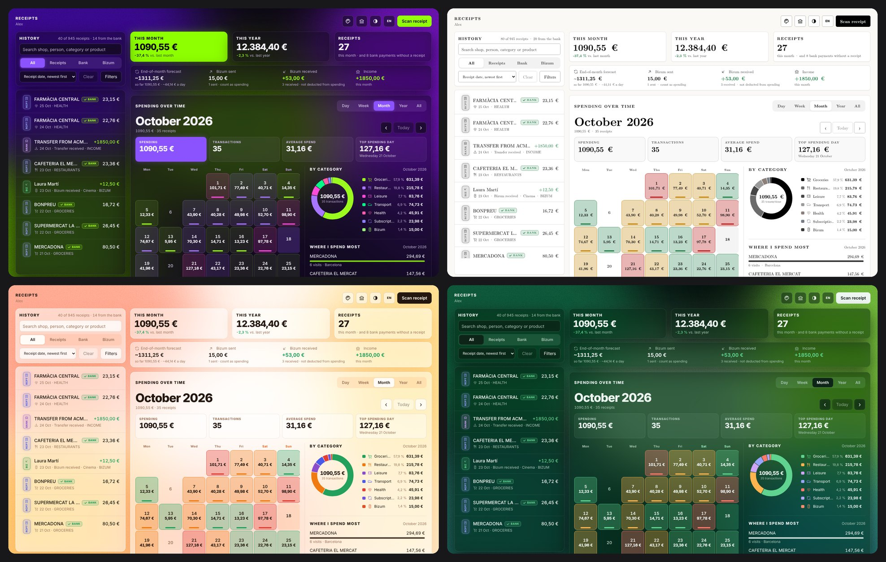

<div align="center">

# ticket-scanner

**Snap a receipt. Know where your money goes.**

A self-hosted expense tracker that reads your receipts with Google Gemini and, optionally,<br>
matches them against your bank account in read-only mode.

[](https://nodejs.org)
[](https://www.sqlite.org)
[](https://ai.google.dev)
[](#more)
[](LICENSE)



</div>

---

Take a photo of a receipt and the app extracts the shop, date, total, line items and category on its own. Connect your bank and it lines those receipts up with your card payments, Bizum transfers and direct debits, so you can see **what** you spend on and **where**, without counting anything twice.

It is built for **one person** and runs on your own computer or home server. Your photos and transactions stay on your machine, in two SQLite files.

> **Note:** the interface is in Spanish, with an English translation (ES / EN button). Bank statement parsing is tuned for Spanish banks (Santander in particular).

## Contents

- [Features](#features)
- [Screenshots](#screenshots)
- [What leaves your machine](#what-leaves-your-machine)
- [Quick start](#quick-start)
- [Connecting Gemini](#connecting-gemini-required)
- [Map and places](#map-and-places-optional)
- [Connecting your bank](#connecting-your-bank-optional)
- [Running it on a server](#running-it-on-a-server)
- [How to use it](#how-to-use-it)
- [Backups](#backups)
- [Project structure](#project-structure)
- [Development](#development)
- [License](#license)

---

## Features

### 🧾 Receipts
- **Upload a photo or a PDF** (receipts, invoices, tickets) from your phone or computer. Gemini reads the shop, address, date and time, total, currency, line items, document type and payment method.
- **Several receipts in one photo**: shoot three at once and you get three entries, each one outlined on the photo.
- **Missing data stays empty, never invented.** An unreadable total is left blank and the entry is flagged for review. A photo is never lost, even when the AI fails.
- **Review screen** to check and fix everything: shop and category first, then the linked bank payment, total and date, split bills, address and line items.
- **Re-analyse** with a different model if you are not happy with the result.
- **Foreign currencies** are converted to euros at that day's exchange rate.

### 📊 Dashboard
- This month's spending compared with your usual spending, plus an end-of-month forecast.
- A monthly calendar with each day's total, with the details on hover.
- Spending by category (donut chart) and over time.
- A unified **history** with search, filters and sorting that mixes receipts and bank transactions.
- A separate panel for **Bizum transfers and income**.

### 📍 Places and map
- Every shop is a **place** with its own page: where it is, which receipts and payments belong to it, and what it is.
- **Google Maps verification**: places are looked up on Google and get their real name, address and location. When there are several candidates, you pick the right one.
- A **map** of where you spend, clustered by area.
- Merge duplicate places, mark a place as an online shop (no location), or flag it as a subscription.

### 🏦 Bank (optional)
- **Reads your transactions** through [Enable Banking](https://enablebanking.com) (PSD2, **read-only**: the app cannot make payments).
- **Automatic sync** every 6 hours, plus a manual sync button.
- **Understands statement descriptions**: card payments, Bizum sent and received, transfers, direct debits, refunds…
- **Matches each payment with its receipt** (same amount, same days, same place). A payment with a receipt is never counted twice.
- **Unifies merchant names**: `MCDONALDS MANRESA` and `MCDONALD'S` end up as the same place (Gemini + Google Maps).
- **Categorises automatically** and learns from your corrections.
- **Subscriptions**: detects recurring charges (monthly, yearly…), lets you confirm or add them, and shows upcoming charges on the calendar.
- **Imports older statements** in Excel or PDF to go further back than the bank connection allows, and **converts a PDF statement to Excel**.
- **Split bills**: mark a payment as shared and record your part; restaurant bills above a set amount ask you automatically.

### ✨ More
- **Installable app** on phone and desktop (PWA).
- **Real time across devices**: upload a receipt on your phone and it appears on your computer.
- **Light and dark themes** with several colour palettes, from vivid to a sober, almost colourless *Sober* one inspired by LaTeX documents.
- **Spanish or English** interface, with an ES / EN switch.

---

## Screenshots

<table>
  <tr>
    <td width="50%"><br><sub><b>Receipt review</b>: the photo next to what Gemini read, ready to correct.</sub></td>
    <td width="50%"><br><sub><b>Bank</b>: sync status, accounts, transactions and subscriptions.</sub></td>
  </tr>
  <tr>
    <td width="50%"><br><sub><b>Transaction</b>: type, category, place, receipt and split bill.</sub></td>
    <td width="50%"><br><sub><b>Subscriptions</b>: recurring charges detected from the bank, to confirm or dismiss.</sub></td>
  </tr>
  <tr>
    <td width="50%"><br><sub><b>Place</b>: location, Google verification and its activity.</sub></td>
    <td width="50%" align="center"><br><sub><b>Mobile</b>: installed as an app.</sub></td>
  </tr>
</table>

<sub>All names, amounts and accounts in the screenshots are made up.</sub>

### Themes

Light or dark, in seven palettes: Original, Green, Magenta, Yellow, Red, Lime and Sober.



---

## What leaves your machine

Everything is stored locally: `database/` (the SQLite files) and `uploads/` (the photos). Only what each feature needs is sent out, and only if you enable it:

| Service | What it receives | When |
|---|---|---|
| **Google Gemini** | The receipt photo or PDF. Bank merchant names and descriptions, to identify and categorise them | When a receipt is analysed; in the background for bank data |
| **Google Places** *(optional)* | Place name and address | When a new place is verified |
| **Google Maps** *(optional)* | What any web map sees: the area you are looking at | When the map is open |
| **Nominatim / OpenStreetMap** *(optional)* | The place's address | Once per place, to locate it |
| **Enable Banking** *(optional)* | Your bank access consent | When connecting and on every sync |
| **Frankfurter** | Currency and date | When converting a foreign-currency receipt |

Bank statements you import (Excel or PDF) are parsed **in your browser**; only the rows reach the server. The interface loads a few libraries from public CDNs (Tailwind, SheetJS, pdf.js).

> [!WARNING]
> **Gemini free tier:** on the free tier of the Gemini API, Google may use the content you send to improve its products. If you do not want your receipts used that way, enable billing on your Google AI Studio project. See the [Gemini API terms](https://ai.google.dev/gemini-api/terms).

---

## Quick start

Try it on your own computer in a few minutes.

**Requirements:** [Node.js 24+](https://nodejs.org), Git, and a Gemini API key (free, see the next section).

```bash
git clone https://github.com/Ipasky/ticket-scanner.git
cd ticket-scanner
npm install
cp .env.example .env        # Windows (PowerShell): Copy-Item .env.example .env
```

Open `.env` in an editor and fill in at least:

```ini
GEMINI_API_KEY=your-gemini-key
GEMINI_MODELOS=gemini-2.5-pro,gemini-flash-latest

# Password login, for your own computer. On a server, see "Running it on a server".
AUTH_MODE=local
AUTH_PASSWORD_HASH=      # generated by the command below
SESSION_SECRET=          # generated by the command below
```

Generate your password hash. It asks twice without echoing and prints the line for `AUTH_PASSWORD_HASH`:

```bash
npm run hash-password
```

Generate the session secret and paste it into `SESSION_SECRET`:

```bash
node -e "console.log(require('crypto').randomBytes(48).toString('base64url'))"
```

Start it:

```bash
npm start
```

Open **http://localhost:3000**, log in and upload your first receipt.

> [!TIP]
> If `npm install` fails while building `better-sqlite3`, you are missing build tools. On Windows, tick *"Tools for Native Modules"* when installing Node. On Linux, run `sudo apt install build-essential python3`. On macOS, run `xcode-select --install`.

---

## Connecting Gemini *(required)*

Gemini is the Google model that reads the photos.

1. Go to **[Google AI Studio → API keys](https://aistudio.google.com/app/apikey)** and sign in with your Google account.
2. Click **Create API key** and copy it.
3. Paste it into `GEMINI_API_KEY` in `.env`.
4. List the models in `GEMINI_MODELOS`, **from preferred to fallback**, separated by commas:

   ```ini
   GEMINI_MODELOS=gemini-2.5-pro,gemini-flash-latest
   ```

   If the first one is overloaded or out of quota, the app moves on to the next one. When uploading you can force **Mejor** (best: the first model) or **Rápido** (fast: the last one).

To see which models your key can use:

```bash
node src/check_models.js
```

---

## Map and places *(optional)*

The app works without any of this, just without a map and without place verification.

### Locating places (free, OpenStreetMap)

Nominatim requires every client to identify itself. Set a name and your e-mail:

```ini
NOMINATIM_USER_AGENT=ticket-scanner/1.0 (you@example.com)
GEO_PAIS=España
```

To locate all the places you already have in one go: `npm run geocodificar`.

### Verification and map (Google Maps Platform)

You need **two keys** from [Google Cloud](https://console.cloud.google.com/apis/credentials), in a project with billing enabled. Normal personal use fits comfortably within Google's monthly free usage.

| Variable | Enable this API | Restrict it to |
|---|---|---|
| `GOOGLE_PLACES_API_KEY` | **Places API (New)** | That API only. Used by the server |
| `GOOGLE_MAPS_API_KEY` | **Maps JavaScript API** | That API **and** your domain (*Website restrictions*). It is visible in the browser |

Optional: `GOOGLE_MAPS_MAP_ID` with your own Map ID to style the map.

---

## Connecting your bank *(optional)*

The bank connection uses **Enable Banking**, a licensed PSD2 account-information provider. For personal use it is **free** in restricted mode: you can only read the accounts you link yourself.

### 1. Register your application with Enable Banking

1. Create an account at **[enablebanking.com](https://enablebanking.com/sign-in/)** and wait for the confirmation e-mail.
2. In the **[Control Panel → Applications](https://enablebanking.com/cp/applications)**, register a new application:
   - **Environment:** Production. Sandbox only has fake banks.
   - **Private key:** keep the default, *generate in the browser*. **Your browser downloads a `.pem` file.** Keep it safe; it cannot be downloaded again.
   - **Redirect URL:** the address you open the app with, followed by `/banco/vuelta`, for example `https://expenses.yourdomain.com/banco/vuelta`. Production requires `https`. It does not have to be reachable from the internet, because only your browser uses it.
   - **Name, description, e-mail, privacy and terms URLs:** they are not checked in restricted mode, so you can use the app's own URL.
3. Copy the **Application ID** (a UUID such as `12345678-1234-…`). The `.pem` file has the same name.
4. On your new application, click **Link accounts**, choose your bank and authorise. **This step is required**: without it no accounts show up. The application will show as *Restricted* and *Active*, which is expected.

### 2. Configure ticket-scanner

Copy the `.pem` into the project's `keys/` folder (it is git-ignored, so it is never committed) and fill in `.env`:

```ini
ENABLEBANKING_APP_ID=12345678-1234-1234-1234-123456789012
ENABLEBANKING_KEY_PATH=keys/12345678-1234-1234-1234-123456789012.pem
BANCO_REDIRECT_URL=https://expenses.yourdomain.com/banco/vuelta   # exactly the one you registered
BANCO_ASPSP=Santander      # your bank's name as listed in Enable Banking
BANCO_PAIS=ES
```

### 3. Connect from the app

1. Restart the server and open the **Banco** (bank) window.
2. Click **Conectar con el banco**, authorise on your bank's website, and you will be sent back to the app.
3. **Tick the accounts you want to read.** They start unticked.
4. The first sync brings in as many recent months as your bank allows, usually about 90 days. For older history, [import a statement](#importing-older-statements).

### Good to know
- Consent lasts as long as your bank allows, at most 180 days. When it expires, click **Renovar el permiso** (renew).
- Banks limit automatic access to about 4 times a day. The app syncs every 6 hours and, if the bank pushes back, waits until the next day. The manual **Sincronizar ahora** button does not use up that allowance.
- Statement parsing is tuned for **Santander**. Other banks sync just the same, but merchant detection may be less accurate.

### Importing older statements

In **Banco → Importar extracto**, choose the file you downloaded from your online banking:
- **Excel** (`.xls`, `.xlsx`, `.csv`) with the columns *Fecha operación, Fecha valor, Concepto, Importe* and *Saldo* (operation date, value date, description, amount, balance), and the IBAN in the first rows.
- **PDF** account statement (Santander layout). Before importing, the app checks that every balance adds up; if a line is missing or extra, it tells you where.

**Convertir PDF a Excel** does the same and downloads the result as an Excel file, so you can keep or review it. Anything already present, from the bank connection or another statement, is never duplicated.

---

## Running it on a server

To use it from your phone away from home, run it on a server (a Raspberry Pi, a NAS, a VPS…) **behind an authentication portal**. In this mode the app does not manage passwords; it trusts the user the portal tells it about.

```ini
AUTH_MODE=proxy
AUTH_PROXY_IPS_PERMITIDAS=127.0.0.1,::1     # where the portal connects from (K3s: 10.42.0.0/16)
AUTH_PROXY_HEADER=Remote-User               # header that carries the user
AUTH_PORTAL_URL=https://auth.yourdomain.com
AUTH_LOGOUT_URL=https://auth.yourdomain.com/logout
```

| Portal | `AUTH_PROXY_HEADER` |
|---|---|
| Authelia | `Remote-User` (default) |
| oauth2-proxy | `X-Forwarded-User` |
| Cloudflare Access | `Cf-Access-Authenticated-User-Email` |

> [!CAUTION]
> **The app's port must only be reachable through the portal.** Anyone who reaches it directly could impersonate you with a single header. `AUTH_PROXY_IPS_PERMITIDAS` rejects anything that does not come from the portal, but close the port in your firewall as well.

A few more tips:
- Serve the app over **HTTPS**: the bank requires it, and so does the installable app.
- If you use `AUTH_MODE=local` over HTTPS, set `AUTH_COOKIE_SECURE=true`.
- To start it automatically, use a `systemd` service, `pm2` or a container.

Every setting is documented in [`.env.example`](.env.example).

---

## How to use it

1. **Upload a receipt** with the upload button (on a phone you can take the photo directly). Pick a mode: *Automático*, *Mejor* (best) or *Rápido* (fast). It shows up in the history within seconds.
2. **Review it**: open the receipt. The shop and category are at the top; a green dot next to the name means the place is verified on Google. Fix anything that is wrong and save.
3. **Places**: the ↗ arrow next to the name opens the place's page. There you can verify it on Google, set its address by pasting it from Google Maps, mark it as online, or merge it with another place.
4. **Bank**: payments without a receipt show *Falta el tiquet* (missing receipt) in the history. Open a transaction to change its type or category, link it to its receipt, mark it as shared, exclude it from spending (a transfer between your own accounts), or mark it as a subscription.
5. **Changing the place of a payment** only changes that payment. To change it for every payment with the same bank name, tick the checkbox that appears; the app asks you to confirm.
6. **Dashboard**: the calendar, categories and map update on every change, on all your devices.

---

## Backups

All your data lives in two folders. Copy them with the server stopped, or include the `-wal` and `-shm` files:

- `database/` → `tickets.db` (receipts and places) and `banco.db` (bank transactions).
- `uploads/` → the original photos, exactly as uploaded.

Keep your `.env` and the `keys/` folder somewhere safe as well.

---

## Project structure

```text
ticket-scanner/
├── .env.example               Every setting, documented (copy it to .env)
├── package.json               Dependencies and npm scripts
├── LICENSE
├── README.md
│
├── src/
│   ├── app.js                 Entry point: Express server, auth guard, static files
│   ├── check_models.js        Lists the Gemini models your key can use
│   │
│   ├── config/
│   │   ├── db.js              SQLite connection and schema migrations
│   │   └── rutas.js           Shared disk paths (uploads, replaced photos)
│   │
│   ├── routes/                HTTP API
│   │   ├── ticket_routes.js       /api/tickets: upload, list, edit, re-analyse
│   │   ├── estadisticas_routes.js /api/estadisticas: dashboard figures
│   │   └── banco_routes.js        /api/banco: connection, sync, transactions, import
│   │
│   ├── controllers/
│   │   ├── ticket_controller.js       Photo → Gemini → validation → database
│   │   └── estadisticas_controller.js Spending by day, category and place
│   │
│   ├── services/
│   │   ├── ai_service.js          Gemini: prompt, schema and model cascade
│   │   ├── normalizacion.js       Checks and cleans everything the AI returns
│   │   ├── establecimientos.js    Place identity: matching and merging
│   │   ├── lugares.js             Google Places verification
│   │   ├── geocodificacion.js     Nominatim geocoding, in the background
│   │   ├── divisas.js             Foreign-currency conversion to euros
│   │   ├── banco.js               Enable Banking: consent, sync, transactions, subscriptions
│   │   ├── banco_analisis.js      Statement parsing, receipt matching, subscription detection
│   │   ├── reglas_categoria.js    Fixed categorisation rules
│   │   ├── eventos.js             Real-time updates (Server-Sent Events)
│   │   ├── auth.js                Proxy or local login, same guard
│   │   ├── password.js            scrypt password hashing
│   │   └── redes.js               IP / CIDR allow-list checks
│   │
│   └── public/                Front end: no framework, no build step
│       ├── index.html             The whole interface (HTML + CSS)
│       ├── app.js                 Interface logic
│       ├── login.html             Login page (local mode)
│       ├── sin-identidad.html     Shown when the portal sends no identity
│       ├── manifest.webmanifest   PWA manifest
│       ├── sw.js · pwa.js         Service worker (never caches your data)
│       └── iconos/                App icons
│
├── scripts/
│   ├── hash_password.js       npm run hash-password
│   ├── geocodificar.js        npm run geocodificar
│   └── generar_iconos.js      npm run iconos
│
├── tests/                     node:test suites (amounts, duplicates, migrations, auth…)
│
├── database/                  Your SQLite databases          (git-ignored)
├── uploads/                   Your receipt photos            (git-ignored)
├── keys/                      Enable Banking private key     (git-ignored)
└── extractos/                 Downloaded bank statements     (git-ignored)
```

---

## Development

| Command | Purpose |
|---|---|
| `npm start` | Start the server (port `PORT`, default 3000) |
| `npm test` | Run the tests (`node:test`, no dependencies) |
| `npm run hash-password` | Generate the local-mode password hash |
| `npm run geocodificar` | Locate pending places on the map |
| `npm run iconos` | Regenerate the PWA icons |
| `node src/check_models.js` | List the Gemini models your key can use |

**Stack:** Node.js 24+, Express, better-sqlite3, `@google/genai`. The front end is plain HTML, Tailwind and vanilla JavaScript, served as is with no build step.

---

## License

[MIT](LICENSE) © 2026 Isaac Pascual
